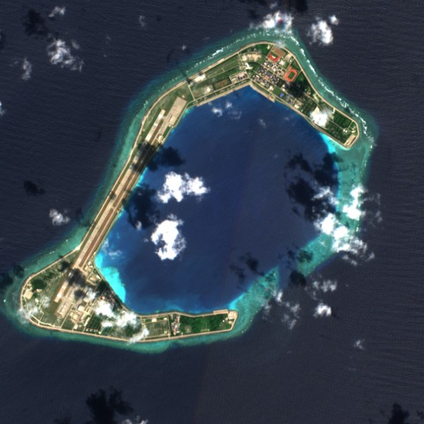
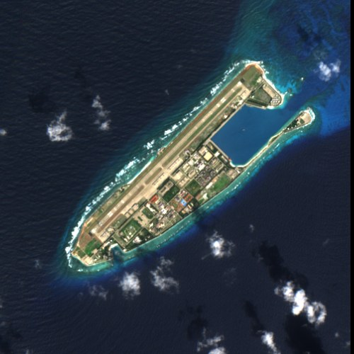
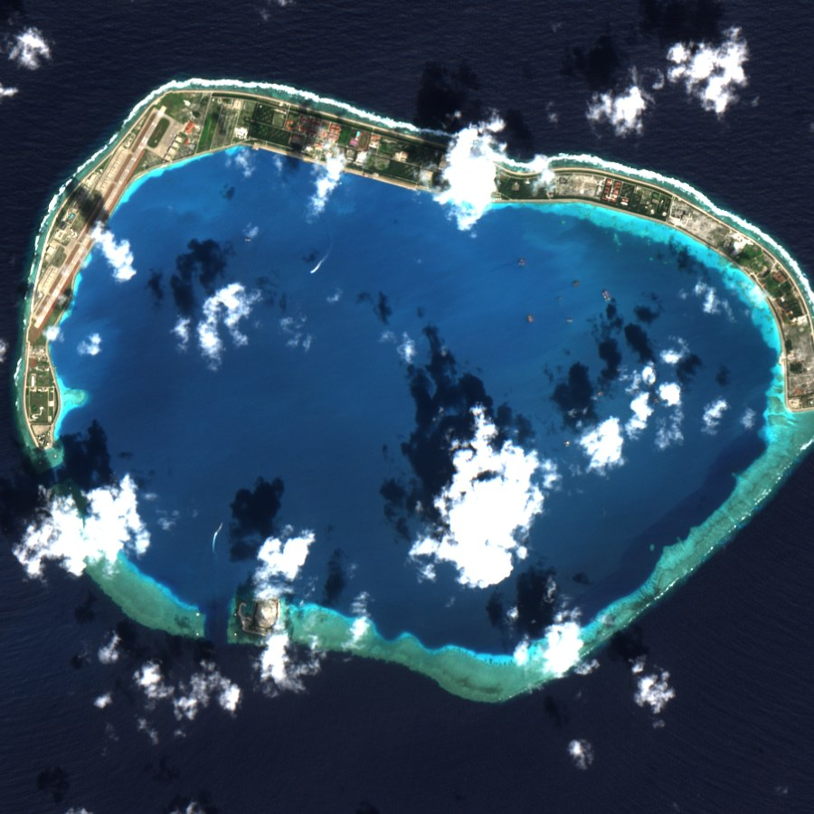
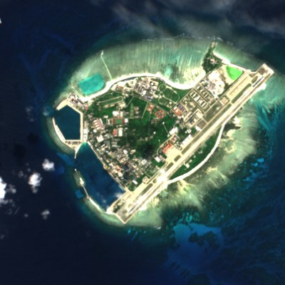
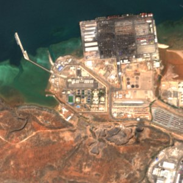
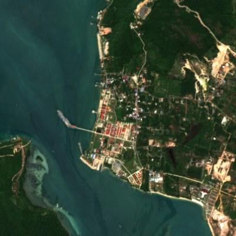
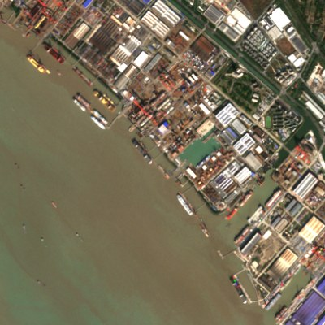
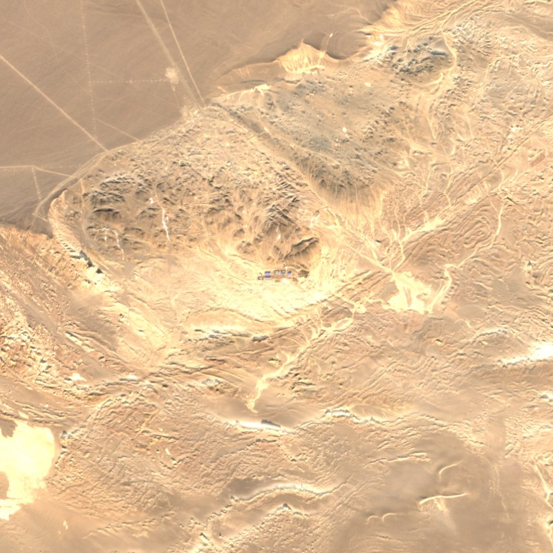

# Build Watch monitor

Automatic change detection on free Sentinel-2 satellite imagery (10 m per pixel) for publicly reported Chinese construction sites. Runs every two days on GitHub Actions; big changes open an Issue in this repo.

_Last run: 2026-11-27 21:57 UTC_

| Site | Latest clear image | Change vs previous | Alerts |
|---|---|---|---|
| **Subi Reef** Spratly Islands |  2026-11-06 · [change map](data/subi/2026-11-06_diff.jpg) | 0.3% since 2026-11-03 | 0 |
| **Fiery Cross Reef** Spratly Islands |  2026-11-23 · [change map](data/fiery/2026-11-23_diff.jpg) | 0.1% since 2026-11-21 | 0 |
| **Mischief Reef** Spratly Islands |  2026-11-23 · [change map](data/mischief/2026-11-23_diff.jpg) | 0.1% since 2026-11-10 | 0 |
| **Woody Island** Paracel Islands |  2026-11-16 · [change map](data/woody/2026-11-16_diff.jpg) | 0.2% since 2026-10-27 | 0 |
| **PLA Support Base Djibouti** Horn of Africa |  2026-11-25 · [change map](data/djibouti/2026-11-25_diff.jpg) | 0.6% since 2026-11-20 | 0 |
| **Ream Naval Base** Cambodia |  2026-11-23 · [change map](data/ream/2026-11-23_diff.jpg) | 0.2% since 2026-11-08 | 0 |
| **Jiangnan Shipyard** Shanghai |  2026-11-25 · [change map](data/jiangnan/2026-11-25_diff.jpg) | 0.2% since 2026-11-20 | 0 |
| **Hami silo field** Xinjiang |  2026-11-24 · [change map](data/hami/2026-11-24_diff.jpg) | 0.0% since 2026-11-22 | 0 |

Imagery: Copernicus Sentinel-2 via Element 84 Earth Search. Change % is the share of the usable area whose colour changed noticeably; clouds, haze and boats can cause false alarms, so check each alert by eye.

**Run it now:** Actions tab → *Monitor sites* → *Run workflow*. **Add a site:** add a line to `sites.json`. **Get alerts by email:** Watch this repo → Custom → Issues.
